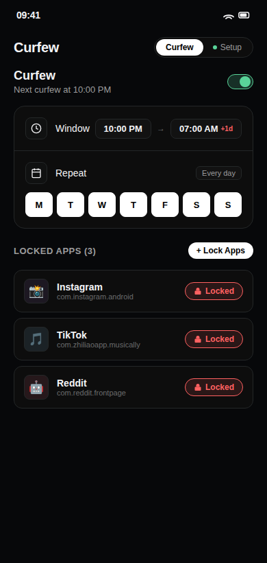
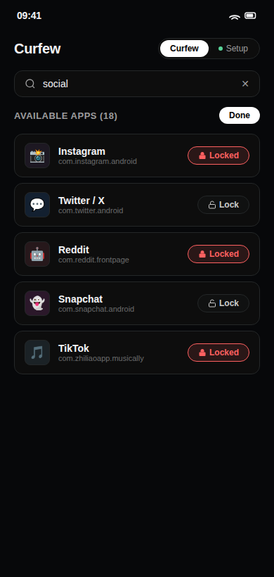
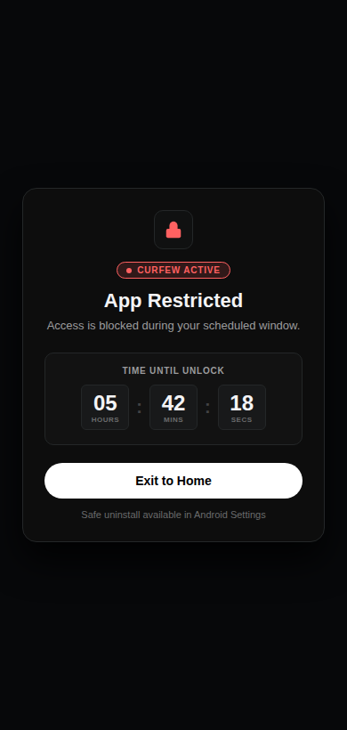

# Curfew

An offline, privacy-first Android app blocker enforcing strict screen-time curfews with hard lockout policies, sub-10ms native overlays, and boot persistence.

[](https://www.android.com/)
[](https://reactnative.dev/)
[](https://expo.dev/)
[](#privacy--design-principles)
[](https://github.com/Deepakeon/curfew/releases)

---

## Download

Get the latest production-ready APK directly from [GitHub Releases](https://github.com/Deepakeon/curfew/releases):

- Download APK packages from the [Latest Release](https://github.com/Deepakeon/curfew/releases/latest).
- Pre-built split APKs are available for `arm64-v8a`, `armeabi-v7a`, `x86_64`, `x86`, and `universal` architectures.

---

## Screenshots

| Schedule Setup | App Selection | Lockout Overlay |
| :---: | :---: | :---: |
|  |  |  |

---

## What It Does (Core Features)

- **Strict lockouts (no bypass/snooze)**: When a curfew is active, target apps cannot be opened. No snooze, no grace period, and no in-app settings modification until the window closes.
- **Overnight schedule support (midnight crossing)**: Easily configure schedules that cross midnight (e.g., 22:00 to 07:00) with automatic next-day boundary handling.
- **100% offline & zero tracking**: Operates entirely on-device with zero telemetry, zero analytics, zero external network calls, and no account creation.
- **Safe uninstall via Android Settings (no device admin lock)**: No Device Administrator lock-in or anti-uninstall shields. Users can always uninstall the app safely through Android Settings.

---

## Permissions & Explanations

Curfew requires three standard Android permissions to enforce lockouts reliably:

- **Usage Access (`PACKAGE_USAGE_STATS`)**: Detects active foreground applications for curfew evaluation.
- **Display Over Other Apps (`SYSTEM_ALERT_WINDOW`)**: Renders full-screen lockout countdown over target apps.
- **Ignore Battery Optimizations**: Keeps background monitor service resident and prevents system termination.

---

## Running the Project

### Prerequisites

- **Node.js**: v18+ or v20+
- **JDK**: Java Development Kit 17
- **Android SDK**: Android 14 (API 34) platform tools & build tools
- **Expo CLI**: Bundled with `npx expo`

### Setup

```bash
# Clone repository
git clone https://github.com/Deepakeon/curfew.git
cd curfew

# Install dependencies
npm install
```

### Running Locally

```bash
# Typecheck TypeScript codebase
npm run typecheck

# Run unit and integration tests
npm test

# Generate native android project via Expo config plugins
npm run prebuild

# Launch Android debug build on connected device/emulator
npm run android:debug

# Launch Android release build locally
npm run android:release
```

### Gradle APK Commands

```bash
# Build Debug APK directly (output: android/app/build/outputs/apk/debug/app-debug.apk)
npm run build:android:debug

# Build Release APK directly (requires valid keystore.properties)
npm run build:android:release

# Build universal and all ABI split Release APKs (arm64-v8a, armeabi-v7a, x86_64, x86, universal)
npm run build:android:release:all

# Build specific ABI Release APK locally
npm run build:android:release:arm64
npm run build:android:release:arm32
npm run build:android:release:x86_64
npm run build:android:release:x86
npm run build:android:release:universal
```

---

## Release Builds & CI/CD

### Required GitHub Repository Secrets

To build and sign production release APKs in GitHub Actions, configure the following secrets under **Settings > Secrets and variables > Actions > Repository secrets**:

| Secret Name | Description | Example / Notes |
|---|---|---|
| `ANDROID_KEYSTORE_BASE64` | Base64-encoded release keystore file (`.jks` / `.keystore`) | Generated via `base64 -w 0 path/to/keystore.jks` (Linux) or `base64 -i path/to/keystore.jks` (macOS) |
| `KEYSTORE_PASSWORD` | Password for the release keystore | Keystore store password |
| `KEY_ALIAS` | Key alias name inside the keystore | Alias specified when creating the key |
| `KEY_PASSWORD` | Password for the key alias | Alias key password |

#### How to Encode the Keystore File

Generate the base64 string to store in `ANDROID_KEYSTORE_BASE64`:

```bash
# Linux
base64 -w 0 ~/.android/keys/curfew-release.jks

# macOS
base64 -i ~/.android/keys/curfew-release.jks
```

### GitHub Actions Workflow

The release workflow is defined in [`.github/workflows/build-release-apk.yml`](.github/workflows/build-release-apk.yml) and is triggered manually:

- **Manual dispatch (`workflow_dispatch`)**: Trigger from the GitHub Actions tab with configurable inputs:
  - `target_ref`: Optional branch, tag, or commit SHA to build.
  - `version_name`: Version name override (e.g. `1.1.0`), passed via Gradle property `-PversionName`.
  - `version_code`: Version code override (e.g. `2`), passed via Gradle property `-PversionCode`.
  - `release_title`: When provided, automatically creates a GitHub Release and attaches all APKs.
  - `release_notes`: Markdown release notes and changelog attached to the GitHub Release.

### Artifacts & GitHub Releases

Upon successful build completion:
- The runner securely decodes the keystore into runner temporary storage.
- Builds signed split APKs using Gradle `assembleRelease`.
- Generated APKs are automatically named with the version and architecture:
  `curfew_V<versionName>_<abi>.apk` (e.g., `curfew_V1.0.0_arm64-v8a.apk`, `curfew_V1.0.0_universal.apk`).
- Keystore files are automatically wiped on completion (`if: always()`).
- All signed APKs are uploaded and available for download as the `curfew-apks` workflow artifact.
- If `release_title` is provided, a GitHub Release is published with release notes and all split APKs attached as release assets.

---

## Privacy & Design Principles

- **No Network Requests**: Curfew does not request network privileges for runtime operation and contains zero remote API endpoints.
- **No Data Collection**: Target app selections and schedules remain 100% on-device in private Android storage.
- **Safety by Design**: By omitting Device Administration interception shields, users retain final ownership of their devices via normal uninstallation in Android Settings.

---

## License

This project is licensed under the [Apache License 2.0](LICENSE).
